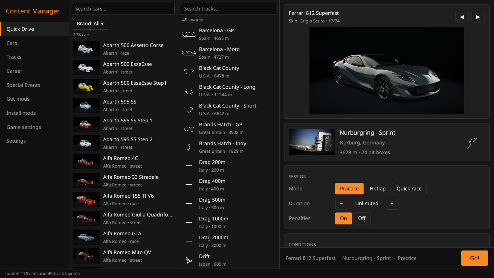
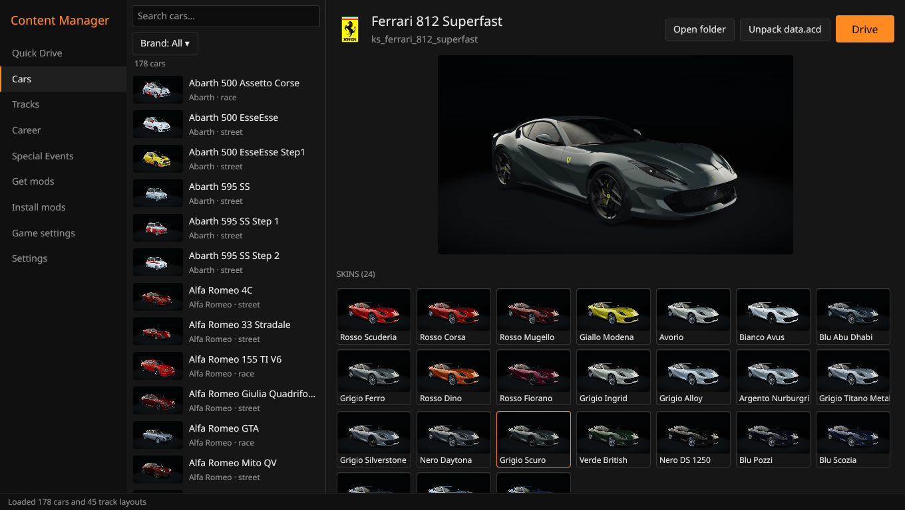
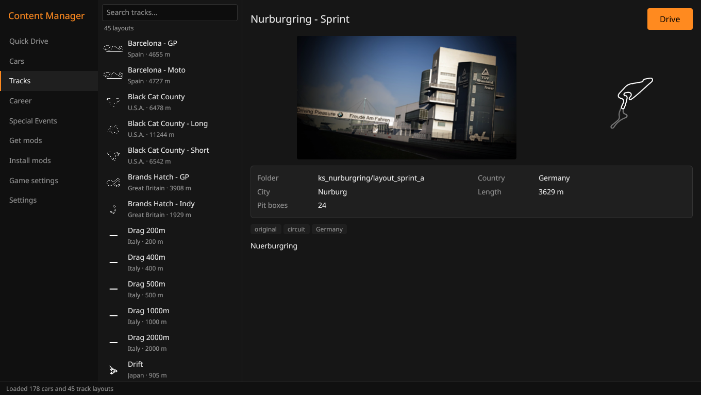
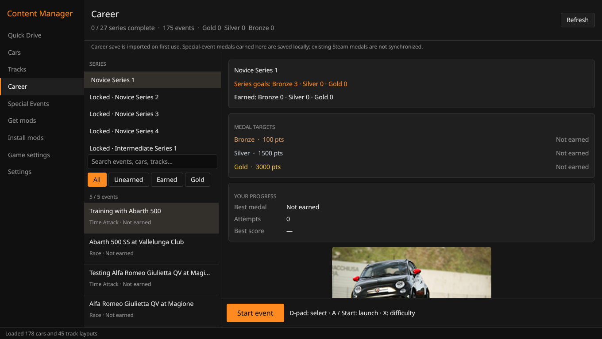
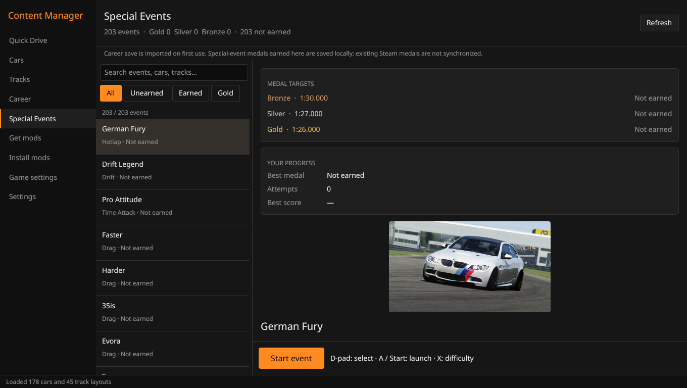

# content-manager-linux (`cm-rs`)

A native rewrite of [Content Manager](https://github.com/gro-ove/actools) for Assetto Corsa in Rust using [GPUI](https://gpui.rs) (Zed's GPU-accelerated UI framework).

It runs natively on Linux (and Windows), launching `acs.exe` through Proton with proper Steam runtime container integration and controller support.



---

## Screenshots

| Cars & Liveries | Track Layouts |
| :---: | :---: |
|  |  |

| Career Mode | Special Events |
| :---: | :---: |
|  |  |

---

## Features

- **Quick Drive**: Pick car, skin, track, and layout. Practice, Hotlap, or Quick Race against AI (configurable laps, opponent count, AI strength, and starting grid slot). Controls for time of day, ambient temperature (using Content Manager's road temperature model), weather presets, and track penalties. Prepares `race.ini` and launches `acs.exe`.
- **Cars**: Filter and search across car models and brands. Detailed specs, badges, descriptions, and skin/livery picker. Unpack encrypted `data.acd` to `data/` and pack edited `data/` back into `data.acd` (with automated backups).
- **Tracks**: Full track and layout browser with map previews, track outlines, length, and pit box capacity.
- **Career & Special Events**: Full career mode series progression, series unlock criteria, AI opponent setups, championship points, medal targets (Gold/Silver/Bronze), and personal record tracking.
- **Embedded Mod Browser (Get mods)**: Integrated CEF/Chromium browser with persistent browsing sessions, bookmarks, and direct mod download capture.
- **Mod Installer**: Drag-and-drop or file pick `.zip` archives. Automatically detects car and track structures and extracts them cleanly into your Assetto Corsa directory.
- **In-Game Settings**: Video, audio, UI, and input configuration with gamepad bind capture and direct AC INI editing.
- **Gamepad Navigation**: Drive launcher navigation with controller buttons and d-pad.
- **CLI Tools**: Scriptable terminal utilities for headless tasks (`cm-rs list cars|tracks|events`, `cm-rs acd unpack|pack`, `cm-rs install`, `cm-rs where`).

---

## Getting Started (Linux)

### 1. Steam & Proton Setup
1. In Steam, enable Proton for Assetto Corsa (Proton-GE 9-20 or newer is recommended).
2. Launch the game once from Steam so it generates the Proton prefix directory (`steamapps/compatdata/244210`).

### 2. Nix / NixOS (Recommended)

Run directly via the development shell:
```sh
nix develop path:. -c cargo run --release -p cm-app
```

Or build the standalone package and desktop launcher:
```sh
nix build path:.
./result/bin/cm-rs
```

### 3. Native Build (Arch / Debian / Ubuntu / Fedora)

Install the required build dependencies:

- **Debian / Ubuntu**:
  ```sh
  sudo apt install build-essential pkg-config cmake ninja-build \
      libxkbcommon-x11-dev libwayland-dev libx11-xcb-dev \
      libfontconfig-dev libvulkan1 mesa-vulkan-drivers
  ```
- **Arch**:
  ```sh
  sudo pacman -S base-devel cmake ninja pkgconf libxkbcommon-x11 wayland libxcb fontconfig vulkan-icd-loader
  ```
- **Fedora**:
  ```sh
  sudo dnf install gcc gcc-c++ cmake ninja-build pkgconf \
      libxkbcommon-x11-devel wayland-devel libxcb-devel \
      fontconfig-devel vulkan-loader
  ```

Build with Rust (1.80+):
```sh
cargo build --release -p cm-app
./target/release/cm-rs
```

---

## Proton Launching & Gamepad Details

When you hit **Go!**, the launcher writes `race.ini` into your Proton prefix (`.../pfx/drive_c/users/steamuser/Documents/Assetto Corsa/cfg`) and launches `acs.exe`.

- **On NixOS / Steam runtime hosts**: If `steam-run` is detected on PATH, the game is launched inside `steam-run` with clean library paths.
- **Gamepad / Wheel in Proton**: Assetto Corsa reads gamepad input via XInput (`INPUT_METHOD=X360`). The launcher ensures Steam's `libSDL2` is available to Wine and sets `PROTON_DISABLE_HIDRAW` so controllers (e.g. DualShock / DualSense) are properly routed through SDL to XInput rather than captured as raw HID devices.

---

## App Configuration

Configuration is stored in `~/.config/cm-rs/settings.toml` (following XDG standards).
- On first launch, existing legacy `settings.json` is automatically migrated.
- The active car, track, skin, and conditions from your last Quick Drive session are remembered across launches.
- Custom Proton binary paths and Assetto Corsa install locations can be customized via the Settings tab or directly in `settings.toml`.

---

## CLI Usage

`cm-rs` includes command-line commands for quick inspection or headless scripts:

```sh
# Inspect detected paths (Steam libraries, AC root, Proton binary, compatdata)
cm-rs where

# List installed content
cm-rs list cars
cm-rs list tracks
cm-rs list events

# Decrypt and unpack car data.acd
cm-rs acd unpack content/cars/ks_ferrari_812_superfast/data.acd

# Encrypt data/ folder back into data.acd
cm-rs acd pack content/cars/ks_ferrari_812_superfast/data

# Install car/track mod archives
cm-rs install mod-package.zip
```

---

## Project Structure

- `crates/ac-core`: Pure domain logic, file format handlers, and game configuration (no UI).
  - `acd.rs`: Encryption / decryption for `data.acd`.
  - `ini.rs`: Order-preserving AC INI parser and writer.
  - `content.rs`: Car, track, skin, and weather catalog scanners.
  - `events.rs`: Career series, special events, medal targets, and progress tracking.
  - `race.rs`: `race.ini` generator and session setup.
  - `launch.rs`: Proton runner, runtime environment isolation, and process execution.
  - `paths.rs`: Steam library, AC root, and compatdata directory discovery.
  - `install.rs`: Mod archive inspection and layout extraction.
  - `game_cfg.rs` & `gamepad.rs`: Assetto Corsa configuration files and controller capture.
- `crates/cm-app`: GPUI desktop application and CLI entrypoint.

---

## Provenance & Attribution

- File format logic and setup conventions follow Assetto Corsa's AcTools library (MS-PL, © gro-ove).
- `data.acd` key derivation was reverse-engineered from `AcTools.AcdEncryption` in Content Manager 0.8.2782 for file-format interoperability.
- No closed license checks, proprietary keys, or private API endpoints from `AcManager.Internal` are included.
- Text input component adapted from GPUI's example implementation (Apache-2.0).
